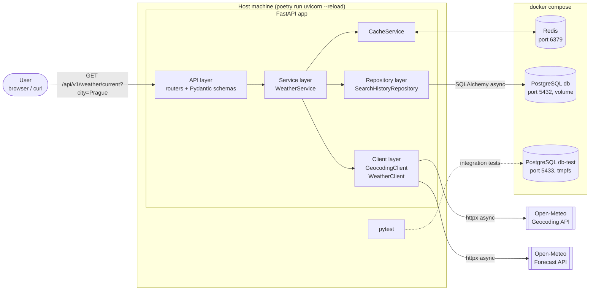
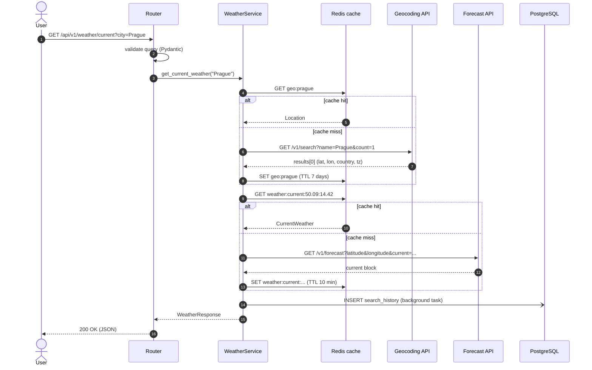
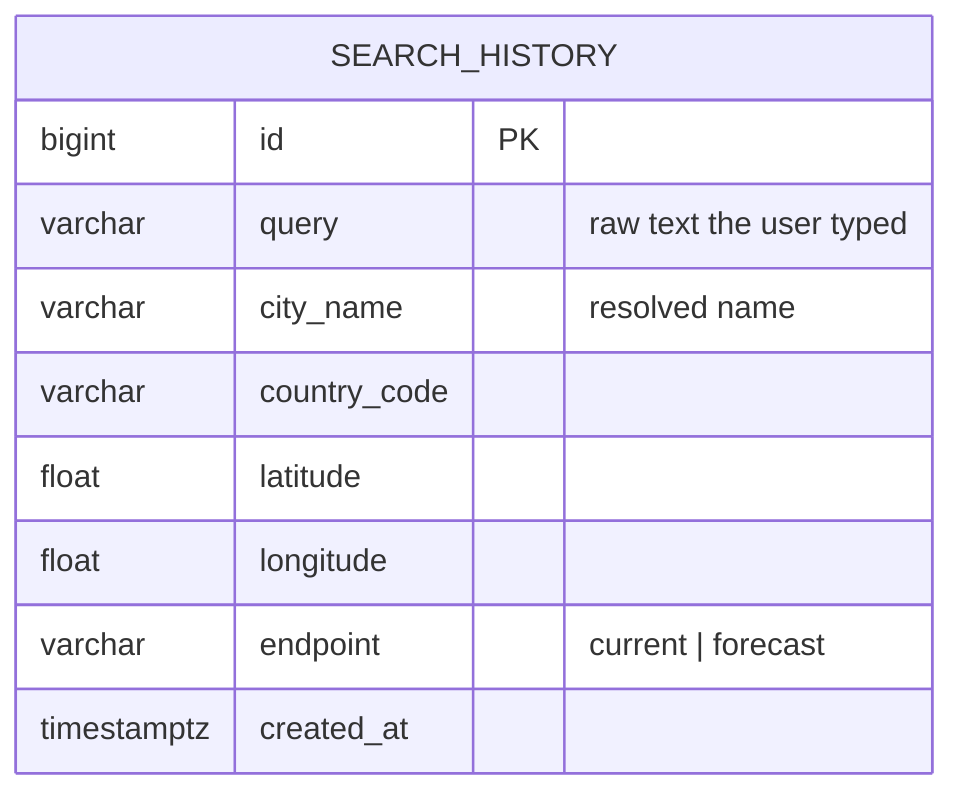
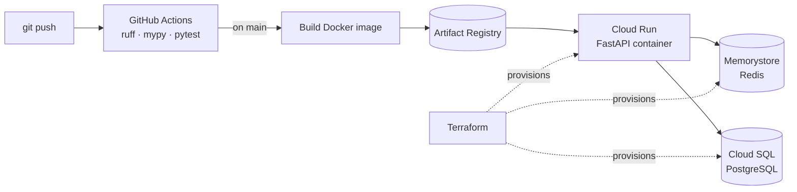

# Weather Forecaster — Architecture

A small async REST API that returns the **current weather** (and a short daily forecast) for a city entered by the user.

The project is deliberately small, but it is built like a production backend service: layered code, typed contracts, async I/O, caching, persistence, tests, containerisation and CI. The goal is to show understanding of **API design** and of the **popular Python backend stack**.

Implementation phases and progress are tracked in [ROADMAP.md](ROADMAP.md). The CI pipeline is set up in Phase 0, and every later phase is merged into `main` through a PR that must pass it.

---

## 1. Requirements

### Functional
| # | Requirement |
|---|-------------|
| F1 | The user enters a city name and gets the current weather (temperature, feels-like, humidity, wind, weather description). |
| F2 | The user can request a daily forecast for 1–16 days (min/max temperature, humidity, sunrise/sunset). |
| F3 | Ambiguous names are handled: the API returns the resolved place (name, country, coordinates) so the user sees *which* "Springfield" was used. Optional `country` filter. |
| F4 | The service stores search history and exposes the most recent / most popular searches. |
| F5 | A minimal web page (or CLI) lets a user type a city and see the result. |

### Non-functional
| # | Requirement |
|---|-------------|
| N1 | Fully async I/O (no blocking calls inside the event loop). |
| N2 | Upstream calls are cached (Redis) to stay fast and respect free API limits. |
| N3 | Clear, consistent error responses (`404` unknown city, `502/504` upstream problems, `422` bad input). |
| N4 | Configuration via environment variables only, no secrets in code. |
| N5 | Tested with pytest; upstream APIs mocked; CI runs lint + type check + tests. |
| N6 | Infrastructure (Postgres, Redis) starts with one command: `docker compose up`; the full stack including the app with `docker compose --profile full up`. |

---

## 2. Tech stack

The stack follows the skills listed in my CV (Python, asyncio, REST APIs, PostgreSQL, Redis, Docker, pytest, Poetry, mocking, GCP/Terraform) and adds the de-facto standard Python web libraries around them.

| Concern | Choice | Why |
|---------|--------|-----|
| Language | **Python 3.12** | Modern typing (`X \| None`, generics), fast asyncio. |
| Web framework | **FastAPI** | Async-first, OpenAPI/Swagger docs generated from types, dependency injection. |
| ASGI server | **Uvicorn** | Standard production server for FastAPI. |
| Validation / schemas | **Pydantic v2** | Request/response models, validation of upstream JSON. |
| Settings | **pydantic-settings** | Typed config from env vars / `.env` (replaces the raw `os.environ[...]` call). |
| HTTP client | **httpx (AsyncClient)** | Async, timeouts, connection pooling, easy to mock. Already used in `modules/connector.py`. |
| Geocoding | **Open-Meteo Geocoding API** (default), GeoNames (optional) | Open-Meteo geocoding is free, keyless and async-friendly via httpx. The current `geopy` GeoNames client is synchronous and needs `asyncio.to_thread`; it can stay as an alternative implementation behind the same interface. |
| Weather data | **Open-Meteo Forecast API** | Free, no API key, `current` and `daily` parameters. |
| Cache | **Redis** + `redis.asyncio` | TTL cache for geocoding and weather responses. |
| Database | **PostgreSQL** | Search history. |
| ORM / driver | **SQLAlchemy 2.0 (async)** + **asyncpg** | Typed `Mapped[...]` models, async sessions. |
| Migrations | **Alembic** | Versioned schema changes. |
| Retries | **tenacity** | Retry transient upstream failures with exponential backoff. |
| Logging | **structlog** (or stdlib `logging` with JSON formatter) | Structured logs with request id. |
| Dependency mgmt | **Poetry** | Lock file, dev dependency groups. |
| Testing | **pytest**, **pytest-asyncio**, **respx** (mock httpx), **fakeredis**, `httpx.ASGITransport` | Unit + API tests without hitting real services. |
| Code quality | **ruff** (lint + format), **mypy**, **pre-commit** | Consistent, type-checked code. |
| Containers | **Docker** (multi-stage) + **docker compose** | Postgres, Redis and a test Postgres for local development; the app's own image for CI and deployment (`full` profile). |
| CI | **GitHub Actions** | Lint → type-check → tests on every push/PR. |
| Frontend (minimal) | **Jinja2 template** served by FastAPI (or a small Vue.js page) | A single form "enter city → show weather". |
| Deploy (optional) | **GCP Cloud Run** + Memorystore + Cloud SQL, provisioned with **Terraform** | Matches CV experience; not required for the core project. |

> **Not used on purpose:** `pandas`. The current connector converts the response into a DataFrame, but an API returns JSON, so Pydantic models are the right shape. Pandas adds a heavy dependency for no benefit here. gRPC/RabbitMQ are also out of scope: a single service with one client has no need for them (see *Possible extensions*).

---

## 3. High-level architecture

The diagram shows the **local development** setup: the FastAPI app runs directly on the host (Poetry virtualenv, `uvicorn --reload`), and Docker Compose runs only the infrastructure it needs.



### Runtime setups

| Setup | Command | FastAPI runs | Containers |
|-------|---------|--------------|------------|
| **Local development** | `docker compose up -d` + `poetry run uvicorn app.main:app --reload` | On the host | `redis`, `db`, `db-test` |
| **Tests** | `poetry run pytest` | In-process (ASGI transport) | `db-test` (from Phase 4). External APIs are mocked, Redis is faked |
| **Full stack** | `docker compose --profile full up` | In the `api` container | `api`, `redis`, `db` |
| **CI** | GitHub Actions | In-process for tests; the image is built and smoke-tested | GitHub service containers (Postgres) |
| **Production** (optional) | Terraform + Cloud Run | Cloud Run container | Managed: Memorystore, Cloud SQL |

The `api` image exists even though development happens on the host, because the image is what gets deployed and what CI checks.

### Layers and responsibilities

| Layer | Knows about | Does **not** know about |
|-------|-------------|-------------------------|
| **API** (`app/api`) | HTTP: paths, query params, status codes, response models | Upstream URLs, Redis, SQL |
| **Service** (`app/services`) | Business flow: resolve city → check cache → fetch weather → save history | HTTP request/response objects |
| **Clients** (`app/clients`) | One external API each, its URL, params and raw JSON → domain model mapping | Caching, DB |
| **Repository** (`app/db`) | SQL / ORM queries | HTTP, external APIs |
| **Cache** (`app/cache`) | Redis keys, TTLs, (de)serialisation | Business rules |

Every dependency (HTTP client, Redis, DB session, settings) is created once in the FastAPI **lifespan** and injected with `Depends(...)`, so tests can swap any of them.

---

## 4. Request flow



Saving history is done with a FastAPI `BackgroundTasks` so the user never waits for the DB write.

---

## 5. API design

Base path: `/api/v1` (versioned so the contract can evolve). Interactive docs at `/docs` (Swagger) and `/redoc`.

| Method | Path | Query params | Description |
|--------|------|-------------|-------------|
| `GET` | `/api/v1/weather/current` | `city` (str, 1–100 chars, required), `country` (ISO-2, optional), `units` (`metric`\|`imperial`, default `metric`) | Current weather for the city. |
| `GET` | `/api/v1/weather/forecast` | `city`, `country`, `units`, `days` (1–16, default 7) | Daily forecast. |
| `GET` | `/api/v1/locations/search` | `q`, `limit` (1–10) | Candidate places for an ambiguous name (autocomplete). |
| `GET` | `/api/v1/history` | `limit` (1–50, default 10) | Most recent searches. |
| `GET` | `/api/v1/history/popular` | `limit` | Most searched cities (`GROUP BY` + `COUNT`). |
| `GET` | `/health` | — | Liveness: app is running. |
| `GET` | `/health/ready` | — | Readiness: Redis and Postgres reachable. |

### Example response — `GET /api/v1/weather/current?city=Prague`

```json
{
  "location": {
    "name": "Prague",
    "country": "Czechia",
    "country_code": "CZ",
    "latitude": 50.088,
    "longitude": 14.4208,
    "timezone": "Europe/Prague"
  },
  "current": {
    "time": "2026-10-16T14:00",
    "temperature": 12.4,
    "apparent_temperature": 10.9,
    "relative_humidity": 71,
    "wind_speed": 14.2,
    "weather_code": 3,
    "description": "Overcast",
    "is_day": true
  },
  "units": { "temperature": "°C", "wind_speed": "km/h" },
  "cached": false
}
```

### Error format

All errors share one shape, produced by custom exception handlers:

```json
{ "error": { "code": "CITY_NOT_FOUND", "message": "No place found for 'Pragu'." } }
```

| Situation | Exception (domain) | HTTP status |
|-----------|-------------------|-------------|
| Invalid query parameter | FastAPI `RequestValidationError` | `422` |
| Geocoding returned no results | `CityNotFoundError` | `404` |
| Upstream returned 5xx / bad JSON | `UpstreamServiceError` | `502` |
| Upstream timeout | `UpstreamTimeoutError` | `504` |
| Redis down | logged, request continues **without cache** | `200` |

Domain exceptions live in `app/core/exceptions.py`; clients raise them, the API layer maps them to HTTP. This replaces the current pattern of re-wrapping everything into `RuntimeError`, which hides the real cause.

---

## 6. Data model



One table is enough for this scope. Index on `created_at DESC` (recent) and on `(city_name, country_code)` (popular).

### Cache keys

| Key | Value | TTL |
|-----|-------|-----|
| `geo:{normalized_city}:{country}` | `Location` JSON | 7 days (cities don't move) |
| `weather:current:{lat:.2f}:{lon:.2f}:{units}` | `CurrentWeather` JSON | 10 min (Open-Meteo updates ~15 min) |
| `weather:forecast:{lat:.2f}:{lon:.2f}:{days}:{units}` | `DailyForecast` JSON | 1 hour |

Coordinates are rounded to 2 decimals (~1 km) so nearby requests share a cache entry.

---

## 7. Project structure

```
weather_forecaster/
├── app/
│   ├── main.py                  # create_app(), lifespan (httpx client, Redis, DB engine)
│   ├── config.py                # Settings(BaseSettings)
│   ├── api/
│   │   ├── dependencies.py      # get_weather_service, get_session, ...
│   │   ├── errors.py            # exception handlers → JSON error format
│   │   └── routes/
│   │       ├── weather.py
│   │       ├── locations.py
│   │       ├── history.py
│   │       └── health.py
│   ├── schemas/                 # Pydantic models (API contract + domain)
│   │   ├── location.py
│   │   ├── weather.py
│   │   └── history.py
│   ├── services/
│   │   └── weather_service.py   # orchestration: geocode → cache → fetch → history
│   ├── clients/
│   │   ├── base.py              # GeocodingClient abstract base class
│   │   ├── open_meteo_geocoding.py
│   │   ├── geonames_geocoding.py   # optional, existing geopy logic moved here
│   │   ├── open_meteo_weather.py   # evolved from modules/connector.py
│   │   ├── http.py              # shared AsyncClient factory + get_json error mapping
│   │   └── factory.py           # picks the geocoding provider from settings
│   ├── cache/
│   │   └── redis_cache.py
│   ├── db/
│   │   ├── base.py              # DeclarativeBase
│   │   ├── models.py            # SearchHistory
│   │   ├── session.py           # async engine + sessionmaker
│   │   └── repositories.py      # SearchHistoryRepository
│   ├── core/
│   │   ├── exceptions.py
│   │   ├── logging.py
│   │   └── weather_codes.py     # WMO code → "Overcast", "Light rain", ...
│   └── web/
│       └── templates/index.html # minimal "enter a city" page
├── migrations/                  # Alembic
├── tests/
│   ├── conftest.py              # app fixture, fake Redis, test DB, respx router
│   ├── fixtures/                # recorded Open-Meteo JSON samples
│   ├── unit/                    # clients, service, cache, weather_codes
│   └── api/                     # endpoint tests via httpx.AsyncClient + ASGITransport
├── .github/workflows/ci.yml
├── Dockerfile
├── docker-compose.yml           # redis, db, db-test; api under the `full` profile
├── pyproject.toml               # Poetry + ruff + mypy + pytest config
├── .env.example
├── .pre-commit-config.yaml
├── ARCHITECTURE.md
└── README.md
```

---

## 8. Configuration

All settings come from env vars (`.env` locally, secrets manager in the cloud):

| Variable | Example | Purpose |
|----------|---------|---------|
| `APP_ENV` | `dev` | `dev` / `test` / `prod` |
| `DATABASE_URL` | `postgresql+asyncpg://weather:weather@db:5432/weather` | Postgres |
| `REDIS_URL` | `redis://redis:6379/0` | Redis |
| `GEOCODING_PROVIDER` | `open_meteo` | `open_meteo` or `geonames` |
| `GEONAMES_USERNAME` | `my_user` | Only if provider is `geonames` |
| `HTTP_TIMEOUT_SECONDS` | `5` | Upstream timeout |
| `CACHE_TTL_CURRENT_SECONDS` | `600` | Current weather TTL |
| `LOG_LEVEL` | `INFO` | Logging |

---

## 9. Testing strategy

| Level | What | Tools |
|-------|------|-------|
| Unit — clients | Correct params sent, JSON → model mapping, 404/5xx/timeout → domain exceptions | `respx`, JSON fixtures |
| Unit — service | Cache hit skips HTTP; cache miss stores result; Redis failure degrades gracefully | `fakeredis`, mocked clients |
| API | Status codes, response schema, error format, validation (`city=""` → 422) | `httpx.AsyncClient(transport=ASGITransport(app))`, `app.dependency_overrides` |
| DB | Repository insert / recent / popular | Postgres in CI service container (or `testcontainers`) |

Target: ≥ 85 % coverage (`pytest-cov`), no real network calls in the test suite.

---

## 10. Deployment



**Local development:** `docker compose up` starts only the infrastructure (`redis:7`, `postgres:16` for dev and a separate tmpfs-backed `db-test` for tests). The app runs on the host with `poetry run uvicorn app.main:app --reload` for fast reloads and debugging.

**Full stack / CI:** the app's Docker image is added to compose under the `full` profile (`docker compose --profile full up`). CI builds this image and smoke-tests it, because the image is the artefact that gets deployed. Cloud deployment is an optional final step.

---

## 11. Possible extensions

- **Vue.js + TypeScript frontend** with city autocomplete using `/locations/search`.
- **Rate limiting** per IP (`slowapi` or Redis token bucket).
- **Favourite cities** per user with JWT auth (`fastapi-users` or hand-rolled with `python-jose`).
- **Weather alerts**: a scheduled worker publishes "temperature drop" events to **RabbitMQ**; a consumer sends notifications. This is the natural place for messaging, not the main request path.
- **gRPC interface** alongside REST (Protobuf contract for `GetCurrentWeather`) to show both API styles.
- **Observability**: Prometheus metrics (`prometheus-fastapi-instrumentator`), OpenTelemetry tracing.
