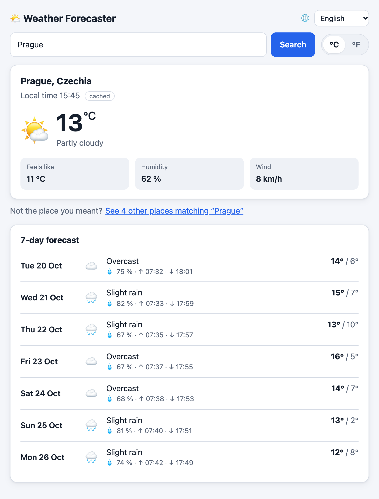
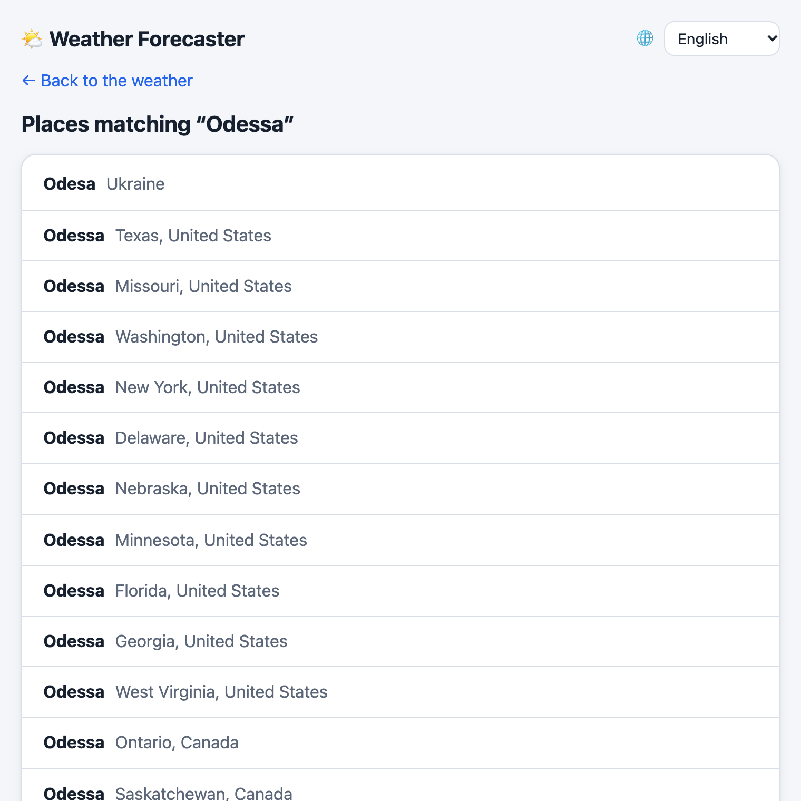
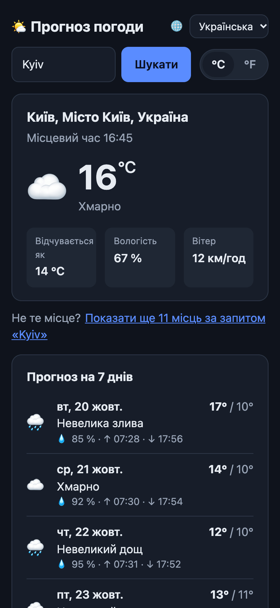
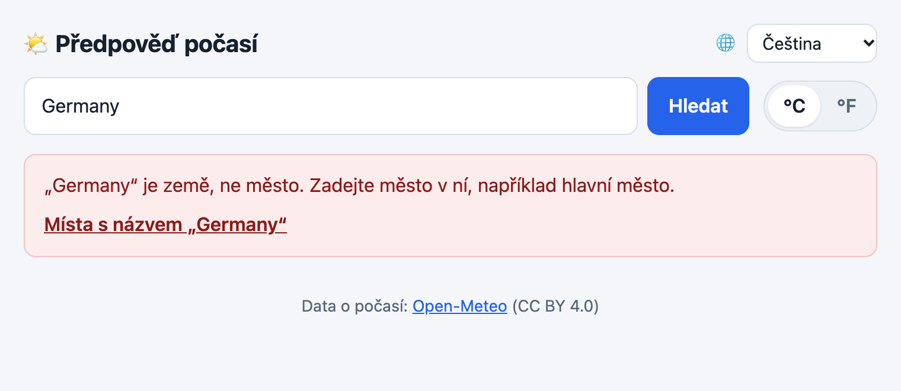

# Weather Forecaster

Current weather and a 7-day forecast for any city: an async FastAPI backend with a Redis
cache, a Vue frontend in four languages, both shipped as Docker images.

<p>
  
  
</p>
<p>
  
  
</p>

- Architecture and tech stack: [ARCHITECTURE.md](ARCHITECTURE.md)
- Implementation phases and progress: [ROADMAP.md](ROADMAP.md)
- What changed in each version: [CHANGELOG.md](CHANGELOG.md)
- API reference: http://localhost:8000/docs once the API runs (OpenAPI, try every endpoint there)

## Quick start

Only Docker is needed:

```bash
git clone git@github.com:loktiyur/weather_forecaster.git && cd weather_forecaster
docker compose --profile full up -d --build     # builds and starts web, api and redis
open http://localhost:8080                      # the app (API docs: http://localhost:8080/docs)
docker compose --profile full down              # stop everything
```

Released versions can also run from the published images, without building:
`ghcr.io/loktiyur/weather-forecaster-api:1.0.0` and `ghcr.io/loktiyur/weather-forecaster-web:1.0.0`
(see [Releases](#releases)). For development, read on.

## Requirements

- Python 3.12
- [Poetry](https://python-poetry.org/) 2.x (`brew install poetry` on macOS)
- Node.js 24+ and npm (for the web frontend)
- Docker with Docker Compose (for Redis, and to run the whole app in containers)

## Setup

```bash
poetry install                    # create the virtualenv and install all dependencies
cp .env.example .env              # local settings (never committed)
poetry run pre-commit install     # run the checks automatically on every git commit
npm --prefix frontend ci          # install the frontend dependencies
```

## Two ways to run

| | Development | Full stack |
|---|---|---|
| App runs | on your machine: API with `uvicorn --reload`, frontend with `npm run dev` (both reload on every change) | in the `api` and `web` containers (the images that get deployed) |
| Docker runs | Redis only | Redis + API + web |
| Open | http://localhost:5173 | http://localhost:8080 |
| Use it for | writing code, debugging | checking the real images, demos |

## Infrastructure (Docker)

In development Docker Compose runs only the infrastructure; the app runs on your machine.

```bash
docker compose up -d       # start Redis (dev, port 6379) and redis-test (port 6380)
docker compose ps          # both should be "healthy"
docker compose down        # stop them (the dev cache survives in a volume)
```

| Service | Port | Used by |
|---------|------|---------|
| `redis` | 6379 | the app (`REDIS_URL`), keeps its data across restarts |
| `redis-test` | 6380 | integration tests only, emptied by every test, nothing saved to disk |

Without Redis the app still works: every request calls the weather APIs, a warning is logged and `/health/ready` returns `503`.

## Run the app

```bash
poetry run uvicorn app.main:app --reload
```

`--reload` restarts the server whenever a file changes. Stop it with `Ctrl+C`.

| URL | What you get |
|-----|--------------|
| http://localhost:8000/docs | Swagger UI: interactive API docs, try every endpoint from the browser |
| http://localhost:8000/redoc | ReDoc: alternative read-only API docs |
| http://localhost:8000/health | `{"status":"ok"}`: the app is running |
| http://localhost:8000/health/ready | `200` if Redis is reachable, `503` if not |

The API itself has no page at `/` (it returns a `NOT_FOUND` error); the web page is the frontend below.

## Run the frontend

With the API running (previous section), in a second terminal:

```bash
cd frontend
npm run dev          # http://localhost:5173, reloads on every change
```

The Vite dev server forwards `/api` and `/health` to http://localhost:8000, so the browser talks to one
origin and no CORS setup is needed (another backend: `API_PROXY_TARGET=http://localhost:8001 npm run dev`).

| What | Where |
|------|-------|
| Search | type a city; the search is kept in the URL (`/?city=Prague`, or `/?id=4401659&city=Odessa` for one exact place), so it can be bookmarked, shared and the back button works |
| Ambiguous names | "Not the place you meant? See 19 other places matching “Odessa”" opens `/places?q=Odessa`: every place the name matches, each linking to exactly that place (Odessa, Missouri instead of Odesa, Ukraine) |
| Units | °C / °F toggle, remembered in the browser |
| Languages | English, Українська, Čeština, Русский in the header (🌐); remembered in the browser, the browser's language is the first default. Place names, weather descriptions and dates follow the language, and a city can be typed in any of these alphabets (`Київ` works with an English interface) |
| Errors | each backend error code has its own message; temporary problems offer "Try again" |

### The API contract

The frontend's TypeScript types are **generated** from the backend's OpenAPI schema
(`frontend/openapi.json` → `frontend/src/api/schema.d.ts`). After changing an API model or endpoint:

```bash
poetry run poe generate-api      # export the schema and regenerate the types
npm --prefix frontend run type-check
```

The type check then points at every component that has to follow the change, and CI fails if the
committed types do not match the backend.

### Frontend checks

```bash
cd frontend
npm run check        # lint (ESLint), format check (Prettier), type check (vue-tsc), tests (Vitest)
npm run lint:fix     # fix lint problems
npm run format       # format the code
npm run test:watch   # re-run tests on every change
npm run build        # production build into dist/
```

## Run the full stack in Docker

```bash
docker compose --profile full up -d --build    # build the images, start web + api + redis
docker compose --profile full ps               # api and web should be "healthy"
open http://localhost:8080                     # the app
poetry run poe smoke-test http://localhost:8000 http://localhost:8080   # end-to-end check
docker compose --profile full logs -f api      # follow the API logs (Ctrl+C to stop following)
docker compose --profile full down             # stop everything
```

- **http://localhost:8080** is the web app. nginx serves it and forwards `/api`, `/health` and
  `/docs` to the API container, so http://localhost:8080/docs works too.
- The API is also published directly on http://localhost:8000. Stop a running dev server first, or
  use other host ports: `API_PORT=8001 WEB_PORT=8081 docker compose --profile full up -d`.

- Without `--profile full`, `docker compose up` still starts only the infrastructure.
- The container reads optional settings from `.env` (e.g. `GEOCODING_PROVIDER`), but always uses
  `REDIS_URL=redis://redis:6379/0`, the Redis container's name inside the Compose network.
- Both images run as non-root users. The API image contains only `app/` and its runtime dependencies;
  the web image only nginx and the built files. Both `.dockerignore` files are allow-lists, so tests,
  `.env` or `node_modules` cannot slip in.
- Docker's healthcheck uses `/health` (liveness): a Redis outage makes `/health/ready` return `503`,
  but the container stays healthy and keeps answering, just without the cache.

`poe smoke-test` calls the real Open-Meteo API once, because its job is to prove the running
container works end to end; the test suite itself never calls external APIs.

## Logs

The API logs with [structlog](https://www.structlog.org/): readable lines on your terminal,
one JSON object per line in the container (the image sets `LOG_FORMAT=json`).

```bash
docker compose --profile full logs -f api     # JSON lines
```

```json
{"method": "GET", "path": "/api/v1/weather/current", "query": "city=Brno&lang=cs", "status": 200, "duration_ms": 311.2, "event": "request", "request_id": "3cfaaf2816d5c019117b9116ba28ef57", "logger": "app.access", "level": "info", "timestamp": "2026-10-20T13:47:58.059Z"}
```

Our code writes every line as an **event name plus fields**, so each detail can be searched on
its own (`status`, `attempt`, `key`, ...):

| Event | Level | When | Fields |
|-------|-------|------|--------|
| `request` | info | a request is done (successful health checks are left out) | `method`, `path`, `query`, `status`, `duration_ms` |
| `upstream_retry` | warning | Open-Meteo failed temporarily, trying again | `service`, `attempt`, `max_attempts`, `status` or `error` |
| `upstream_error` / `upstream_timeout` | warning | Open-Meteo still failing after the last attempt | `service` (`detail`) |
| `cache_unavailable` | warning | Redis did not answer; the request goes on without the cache | `operation` (`read` / `write`), `key`, `error` |
| `cache_entry_unreadable` | warning | a cache entry no longer matches the model; treated as a miss | `key` |
| `redis_unreachable` | warning | Redis is down at startup | `redis` (the URL without credentials) |

Lines from libraries (uvicorn's server messages, httpx's `HTTP Request: GET ...` for every call
to Open-Meteo) keep their own text, in the same format and with the same `request_id`.

- **Request id.** Every response has an `X-Request-ID` header, and every log line written while
  the request was handled carries the same `request_id`: the access line, the calls to
  Open-Meteo, any warning. nginx creates the id and writes it into its own access log too
  (`rid=...`), so one id finds a request in both logs:
  ```bash
  docker compose --profile full logs | grep 3cfaaf2816d5c019117b9116ba28ef57
  ```
  A caller can send its own `X-Request-ID` (letters, digits, `.`, `_`, `-`, up to 64); anything
  else is replaced.
- **Health checks** from Docker (every 10 s) are not logged while they succeed; a failing one is.
- **Settings:** `LOG_LEVEL` (`DEBUG`, `INFO`, `WARNING`, `ERROR`; default `INFO`) and
  `LOG_FORMAT` (`text` or `json`), in `.env` or the environment:
  `LOG_LEVEL=DEBUG poetry run uvicorn app.main:app --reload`.

## API

| Endpoint | Query parameters |
|----------|------------------|
| `GET /api/v1/weather/current` | `city` (a name, not a postal code) **or** `id` (a `location.id`, exactly that place), `country` (ISO code, e.g. `CZ`), `region` (e.g. `Texas`, picks one of several same-name places in a country), `lang` (`en` / `uk` / `cs` / `ru`), `units` (`metric` / `imperial`) |
| `GET /api/v1/weather/forecast` | same as above + `days` (1-16, default 7) |
| `GET /api/v1/locations/search` | `q` (required), `country`, `lang`, `limit` (1-20, default 5) |
| `GET /health`, `GET /health/ready` | |

```bash
curl "http://localhost:8000/api/v1/weather/current?city=Prague"
curl "http://localhost:8000/api/v1/weather/current?city=Paris&country=US&units=imperial"
curl "http://localhost:8000/api/v1/weather/current?city=Odessa&country=US&region=Missouri"
curl "http://localhost:8000/api/v1/weather/current?id=4401659&lang=uk"     # Одеса, Міссурі, США
curl -G "http://localhost:8000/api/v1/weather/current" --data-urlencode "city=Київ"  # Kyiv, Ukraine
curl "http://localhost:8000/api/v1/weather/forecast?city=Kyiv&days=3"
curl "http://localhost:8000/api/v1/locations/search?q=Springfield&limit=3"
```

### Caching

Results are cached in Redis: places for 7 days, current weather for 10 minutes, forecasts for 1 hour.
`"cached": true` in the response means the weather came from the cache, and the `Cache-Control` header
lets browsers reuse the response too:

```bash
curl -i "http://localhost:8000/api/v1/weather/current?city=Prague"
# HTTP/1.1 200 OK
# cache-control: public, max-age=600
# ... "cached":false}            ← first call: fetched from Open-Meteo
# (call again)       "cached":true}   ← served from Redis
```

Look into the cache:

```bash
docker compose exec redis redis-cli --scan          # list keys (copy exact names from here)
docker compose exec redis redis-cli ttl geo:en:prague: # seconds left (note the trailing colon)
docker compose exec redis redis-cli monitor         # watch every command live, Ctrl+C to stop
docker compose exec redis redis-cli flushdb         # empty the dev cache
```

`ttl` returns the seconds left, `-2` if the key does not exist (wrong name, or already expired:
current weather lives only 10 minutes) and `-1` if it has no expiry (never the case here).
Place keys start with the language and end with the country code, empty when none was given:
`geo:en:prague:` vs `geo:uk:prague:CZ`. A region is added only when one was given
(`geo:en:odessa:US:missouri`); places looked up by id are `place:4401659:uk`.

### Errors

Every error uses the same format:

```bash
curl "http://localhost:8000/api/v1/weather/current?city=Qwertyuiopxyz"
# 404 {"error":{"code":"CITY_NOT_FOUND","message":"No place found for 'Qwertyuiopxyz'."}}

curl "http://localhost:8000/api/v1/weather/current?city=Germany"
# 404 {"error":{"code":"NOT_A_CITY","message":"'Germany' is a country, not a city."}}

curl "http://localhost:8000/api/v1/weather/forecast?city=Prague&days=40"
# 422 {"error":{"code":"VALIDATION_ERROR","message":"Invalid request parameters.",
#      "details":[{"field":"days","location":"query","message":"Input should be less than or equal to 16"}]}}
```

| Status | `code` | When |
|--------|--------|------|
| 404 | `CITY_NOT_FOUND` | No place matches the name |
| 404 | `NOT_A_CITY` | The name is a country (`Germany`): there is no single place to show |
| 404 | `LOCATION_NOT_FOUND` | No populated place has this `id` |
| 501 | `NOT_SUPPORTED` | The geocoding provider cannot do it: GeoNames (via geopy) has no lookup by `id` |
| 404 / 405 | `NOT_FOUND` / `METHOD_NOT_ALLOWED` | Unknown URL / wrong HTTP method |
| 422 | `VALIDATION_ERROR` | Invalid query parameters (`details` lists each one), e.g. neither `city` nor `id` |
| 502 | `UPSTREAM_ERROR` | Open-Meteo / GeoNames returned an error |
| 504 | `UPSTREAM_TIMEOUT` | Open-Meteo / GeoNames did not answer in time |

Temporary failures of Open-Meteo (timeouts, dropped connections, HTTP 5xx and 429) are retried
up to 3 attempts in total, with short growing pauses (~0.2 s, ~0.4 s) and a time budget of 8 s;
`UPSTREAM_ERROR` / `UPSTREAM_TIMEOUT` come only after the last attempt. Other 4xx answers are
never retried: asking again would give the same answer. Each retry is logged as a warning.

## Checks

Tasks are defined in `pyproject.toml` under `[tool.poe.tasks]` and run with [poethepoet](https://poethepoet.natn.io/).
CI runs exactly the same tasks.

```bash
poetry run poe format-code     # fix lint issues + format everything (run this when the format check fails)
poetry run poe check           # lint, format check, type check, all tests with coverage (needs redis-test, see below)
```

Individual tasks:

```bash
poetry run poe lint              # ruff check
poetry run poe format-check      # ruff format --check (changes nothing)
poetry run poe typecheck         # mypy, strict
poetry run poe test-unit         # unit + API tests, no Docker needed
poetry run poe test-integration  # tests against the real redis-test container
poetry run poe test              # all tests; extra args pass through: poe test -k geocode -v
poetry run poe test-cov          # all tests with coverage, fails below 80 %
poetry run poe --help            # list all tasks
```

### Unit vs. integration tests

- **Unit + API tests** never need infrastructure: external APIs are mocked with respx and the cache
  is a small in-memory test double of our own `Cache` interface.
- **Integration tests** (`@pytest.mark.integration`, in `tests/integration/`) run against a real Redis
  in Docker. **The `redis-test` container must be running, otherwise these tests fail**
  (with a message telling you how to start it):
  ```bash
  docker compose up -d redis-test     # Docker Desktop / Rancher Desktop must be running
  docker compose ps                   # redis-test should be "healthy"
  poetry run poe test-integration
  ```
  `poe test`, `poe test-cov` and `poe check` run all tests, so they need `redis-test` running too.
  Without Docker, use `poe test-unit`.

### CI

`.github/workflows/ci.yml` runs on every pull request and on every push to `main`:

| Job | Steps | On a pull request, runs when it changes |
|-----|-------|-----------------------------------------|
| `Changes` | decides which jobs a pull request needs | always |
| `Lint, type-check, test` | lint, format check, mypy, unit + API tests | `app/`, `tests/`, `scripts/`, Poetry files, `*.md` (ruff checks the Python examples in Markdown) |
| `Redis integration` | starts `redis:7.4-alpine` as a service container, runs the integration tests, then all tests with the coverage gate | `app/`, `tests/`, Poetry files |
| `Docker image` | builds the API and web images, starts the full stack with Compose, runs `scripts/smoke_test.sh` against both | `app/`, `frontend/`, `Dockerfile`, `.dockerignore`, `docker-compose.yml`, `scripts/smoke_test.sh`, Poetry files |
| `Frontend` | API types match the backend, ESLint, Prettier, vue-tsc, Vitest, production build | `frontend/`, `app/` (a backend change can change the API contract), `scripts/export_openapi.py` |
| `CI result` | fails if any job failed; skipped jobs count as passed | always |

- **Pull requests** run only the jobs whose files changed: a README fix runs only the lint job,
  a frontend change skips the Python jobs. A change to `.github/workflows/ci.yml` runs
  everything; a change to the other workflows (release, PR title) runs no job.
- **Pushes to `main`** (every merge) always run every job.
- **`CI result` is the required check for all of them** in the `main` ruleset. A skipped job
  never reports a status of its own, so requiring each job would block every pull request that
  skips one. The ruleset also requires `PR title` (`.github/workflows/pr-title.yml`, see Releases).

## Releases

Versions are set automatically from the commit messages, following
[Conventional Commits](https://www.conventionalcommits.org/) and
[Semantic Versioning](https://semver.org/). With squash merging, the **PR title** is the commit:

| PR title | Release | Example |
|----------|---------|---------|
| `fix: ...` (also `perf:`, `revert:`) | patch | 1.4.2 → 1.4.3 |
| `feat: ...` | minor | 1.9.0 → 1.10.0 (the numbers are counters, not digits) |
| `feat!: ...`, or a `BREAKING CHANGE: ...` line in the description | major | 1.10.0 → 2.0.0 |
| a `Release-As: 2.0.0` line in the description | exactly that version | milestones, like the planned 2.0.0 |
| `chore:`, `docs:`, `ci:`, `test:`, `refactor:`, `build:`, `style:` | no release | they go out with the next release |

The `PR title` check fails a pull request whose title does not follow this format, so no change
is silently left out of a release.

**How a release happens** (`.github/workflows/release.yml`, with
[release-please](https://github.com/googleapis/release-please)):

1. **Every merge into `main`**: release-please opens or updates one pull request,
   `chore: release X.Y.Z`. It bumps the version in `pyproject.toml`, `app/main.py`,
   `frontend/package.json`, `frontend/package-lock.json` and `frontend/openapi.json`, and adds
   the new section to `CHANGELOG.md`, made from the `feat:` and `fix:` titles since the last
   release. A merge that comes before the release PR is merged updates the same PR.
2. **The release PR merges itself** (auto-merge) as soon as CI and `PR title` pass on it, a
   few minutes after your merge. So every `feat:` or `fix:` merge becomes a release, and a PR
   title with the wrong type is released too: there is no step to catch it.
3. release-please then creates the tag `vX.Y.Z` and a GitHub Release with the changelog.
4. **The tag publishes the images** (`.github/workflows/publish.yml`): the workflow checks that the tag matches the versions in
   the code, builds both images, runs the smoke test against them, and only then pushes them to
   GitHub Container Registry:

| Image | Tags (for 1.4.0) |
|-------|------------------|
| `ghcr.io/loktiyur/weather-forecaster-api` | `1.4.0`, `1.4`, `latest` |
| `ghcr.io/loktiyur/weather-forecaster-web` | `1.4.0`, `1.4`, `latest` |

A major version is never automatic: it means "something works differently now", not "a lot
was added". From minor 50 on, the release PR is **not** merged automatically: the workflow
comments on it as a reminder to decide about a milestone release (`Release-As: 2.0.0`), and
you merge it yourself when you are ready.

### One-time setup

1. **Squash merging only**: Settings → General → Pull Requests: allow only *squash merging*,
   with *Default commit message: Pull request title and description* (so `Release-As:` and
   `BREAKING CHANGE:` lines in a description reach the commit). On the same page, turn on
   **Allow auto-merge**, which the release PR uses.
2. **A token for release-please.** GitHub starts no workflows for pull requests, merges and tags
   made with a workflow's own token, so the release PR would get no CI (and could never be
   merged), its merge would create no tag, and the tag would publish no images. Create a *fine-grained personal access token*
   (Settings of your account → Developer settings → Personal access tokens → Fine-grained
   tokens) with access to **this repository only** and the permissions **Contents: read and
   write** and **Pull requests: read and write**. Save it as the repository secret
   `RELEASE_PLEASE_TOKEN` (repository Settings → Secrets and variables → Actions). Note its
   expiry date: when it expires, the release job fails with a message pointing here.
3. **Required checks** in the `main` ruleset: `CI result` and `PR title`.

### First release

release-please counts commits from the last release, so the first one, v1.0.0, is created by
hand once, after this phase is merged:

```bash
git switch main && git pull
gh release create v1.0.0 --target main --title "Weather Forecaster 1.0.0" \
  --notes "$(awk '/^## \[1\.0\.0\]/{f=1; next} /^## |^\[1\.0\.0\]:/{f=0} f' CHANGELOG.md)"
```

The new tag publishes the 1.0.0 images; from then on, releases come from release PRs. Until
v1.0.0 exists, the release job only notes that it is waiting for it.

### Running tests from PyCharm

1. **Settings → Project → Python Interpreter → Add Interpreter → Poetry Environment → Existing**,
   pick the environment Poetry created (`poetry env info --path` prints it).
2. **Settings → Tools → Python Integrated Tools → Testing → Default test runner: `pytest`**.

After that, the green ▶ next to each `test_...` function or at the top of a file runs it with pytest.
Running a test file as a plain Python script does not work: pytest has to collect and run the tests.

Run all pre-commit hooks on the whole repository at once:

```bash
poetry run pre-commit run --all-files
```
